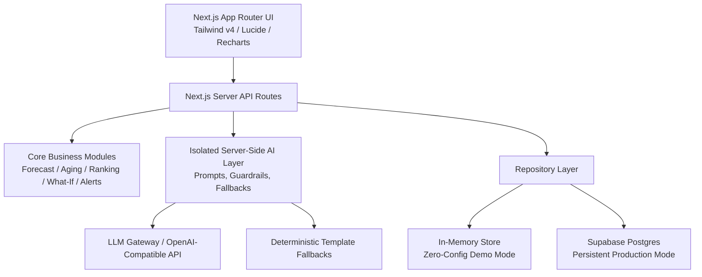

# Payday: Cash Flow OS for Freelance Creative Studios

Payday is a cash-flow intelligence and receivables operating system built for independent creative professionals, freelance wedding photographers, and boutique service studios in India. It bridges the gap between project delivery and bank balance reality by turning scattered client promises and multi-stage milestone invoices into a deterministic 90-day cash runway, automated follow-up drafts, and prioritized action lists.

## Target Persona & Problem Solved

- **Who It Is For**: Freelancers and creative micro-studios (such as Arjun, a wedding photographer in Mumbai) operating on milestone-based billing (Advance, Shoot Day / Mid, Album Delivery / Final).
- **The Problem It Solves**: Creatives often book tens of lakhs in project value but face sudden cash crunches before major vendor payouts or studio rent due to delayed client payments. Traditional accounting software only tells them what happened in the past; Payday tells them who owes them today, when they will run out of cash, and exactly what single action to take next.

---

## Solution Mapping

| Hackathon Requirement | Payday Implementation | Location in App |
| :--- | :--- | :--- |
| **Invoice-to-Payment Flow with Drafted Follow-ups** | Tracks 3-stage milestone invoices (`advance`, `mid`, `final`) from draft to partial/full payment. Features one-click WhatsApp reminder drawer with culturally calibrated tones (`friendly`, `firm`, `final`) and languages (`en`, `hinglish`), WhatsApp `wa.me` deep links with prefilled messages, and dynamic UPI QR generation. | `/invoices`, `/bad-day` |
| **Who-Owes-Me Dashboard** | Single-screen receivables command center with Today summary sentence, total outstanding/overdue KPIs, aging bucket distribution (Not Due, 1–7d, 8–30d, 30+d), and a client ledger sorted by overdue exposure with behavioral reliability indicators. | `/dashboard` |
| **30–90 Day Cash Forecast** | Deterministic cash projection engine running on Indian Standard Time (`Asia/Kolkata`). Adjusts expected invoice receipt dates based on client payment history and overdue catch-up buffer, mapping daily inflows and outflows to compute lowest cash point, runway days, and health status. | `/forecast` |
| **What-If Scenario Modeling** | Interactive stress-testing simulator with one-click presets ("Slowest client pays 15 days late", "Biggest booking cancelled", "Emergency expense") and custom scenario builder. Displays side-by-side delta impact, cash trajectory shifts, and health degradation indicators. | `/forecast` (What-If tab) |
| **Actionable Alerts** | Rule-derived notification engine that evaluates receivables and forecast runway. Every alert ends in a concrete, single typed action ("Send reminder", "Send heads-up", "See what-if") with dismiss and snooze controls. | `/dashboard`, `/bad-day` |

---

## Architecture



- **Framework**: Next.js 16.4.6 (App Router, Turbopack, React 19)
- **Styling**: Tailwind CSS v4, Warm Archival Paper & Hairline stone aesthetic (`#F5F3EE`, `#16181D`, `#1D6B52`)
- **Deterministic Math**: Pure TypeScript modules (`lib/forecast`, `lib/whatif`, `lib/ranking`, `lib/aging`, `lib/alerts`) with zero floating-point rupees errors.
- **Data Layer**: Dual-mode repository pattern (`lib/db/repository.ts`) supporting zero-config in-memory state and Supabase Postgres.
- **Server-Side AI Layer**: Strictly scoped to WhatsApp reminder drafting and natural-language quick-add parsing with 100% deterministic template fallback.

---

## Running the Application

### 1. Demo Mode (Default, Zero Configuration)

Demo mode uses an in-memory repository seeded with a realistic wedding photography studio scenario (Arjun Visuals). It requires no external database or API keys.

```bash
# Install dependencies
npm install

# Start development server
npm run dev
```

Visit [http://localhost:3000](http://localhost:3000) in your browser.

To reset the demo dataset to its initial state at any time, click **Reset Demo Data** in the settings or send a POST request to `/api/demo/reset`.

### 2. Supabase Mode (Persistent Storage)

To connect Payday to a persistent Supabase Postgres instance:

1. Create a Supabase project and execute the SQL schema in `supabase/schema.sql`.
2. Add your Supabase credentials to `.env.local`:
   ```bash
   NEXT_PUBLIC_SUPABASE_URL=https://your-project.supabase.co
   NEXT_PUBLIC_SUPABASE_ANON_KEY=your-anon-key
   SUPABASE_SERVICE_ROLE_KEY=your-service-role-key
   ```
3. Run `npm run build && npm run start`.

---

## Environment Variables

| Variable Name | Required | Description |
| :--- | :--- | :--- |
| `NEXT_PUBLIC_SUPABASE_URL` | No | Supabase project URL (if omitted, runs in Demo Mode) |
| `NEXT_PUBLIC_SUPABASE_ANON_KEY` | No | Supabase public anonymous API key |
| `SUPABASE_SERVICE_ROLE_KEY` | No | Supabase private service role key (server-side only) |
| `LLM_API_KEY` | No | API key for LLM provider (if omitted, deterministic templates are used) |
| `LLM_BASE_URL` | No | Base URL for LLM gateway (e.g. `https://api.groq.com/openai/v1` or OpenAI) |
| `LLM_PRIMARY_MODEL` | No | Primary model name (e.g. `llama-3.3-70b-versatile` or `gpt-4o-mini`) |
| `LLM_FALLBACK_MODEL` | No | Fallback model name |
| `NEXT_PUBLIC_DEMO_RESET` | No | Set to `'true'` to enable demo reset endpoint in non-demo mode |

> [!NOTE]
> All LLM features fall back automatically to deterministic templates if `LLM_API_KEY` is not provided.

---

## Running Tests

```bash
# Run unit tests (Vitest)
npm test

# Run End-to-End tests (Playwright)
npx playwright test

# Run linter
npm run lint

# Build production bundle
npm run build
```

---

## Data Notice

All business data, client names, event titles, contact numbers, email addresses, invoices, and bank transaction entries included in this repository and demo are **100% synthetic** and created exclusively for testing and demonstration purposes. Any resemblance to real persons, living or deceased, or actual businesses is purely coincidental.
