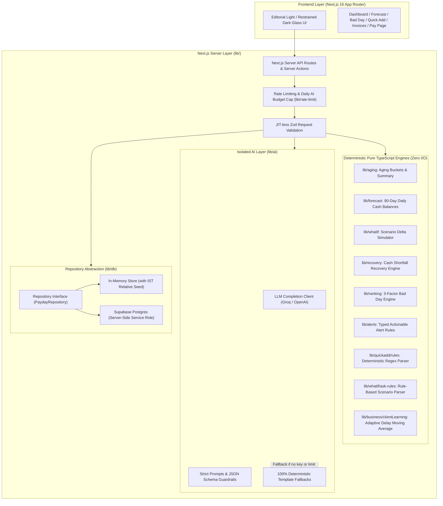

# Payday ⚡
### Cash Flow Intelligence & Receivables Operating System for Freelance Studios

[](https://nextjs.org/)
[](https://react.dev/)
[](https://www.typescriptlang.org/)
[](https://tailwindcss.com/)
[](https://vitest.dev/)
[](https://playwright.dev/)
[](LICENSE)

> **"Small creative businesses don't fail because they lack talent or clients. They fail because money arrives late and bills arrive on time."**

---

## Executive Summary

**Payday** is a one-person financial back office tailored specifically for independent wedding photographers, videographers, and boutique creative studios in India. Operating on lumpy milestone contracts (Advance → Shoot Day/Mid → Final Delivery), solo creatives often have tens of lakhs in receivables on paper while facing negative bank balances when studio rent, equipment EMIs, and assistant salaries fall due.

Traditional accounting software (Tally, QuickBooks, Zoho) is backward-looking—it records what already happened. Payday is **forward-looking receivables intelligence**: it tracks who owes what and since when, forecasts daily bank balances 90 days into the future on Indian Standard Time (IST), stress-tests cash flow with plain-language what-if questions (**Ask Payday**), computes deterministic **Recovery Plans** when projected cash dips below safe buffers, activates **Bad Day Mode** to chase the single highest-impact invoice, and closes the loop with clients via secure **Public Pay Pages** (`/pay/[token]`) with UPI QR codes and payment claim verification.

---

## The Persona: Arjun Verma (Arjun Visuals)

- **Role**: Freelance wedding photographer based in Mumbai with one assistant.
- **Revenue Pattern**: Highly seasonal (heavy bookings from October to February; dead monsoon season from June to August). Each client pays in 3 milestones:
  1. **Advance (20–30%)**: At contract signing / date reservation.
  2. **Mid (40–50%)**: On shoot day or upon delivery of RAW files.
  3. **Final (20–30%)**: Upon album delivery or final color-graded video release.
- **Fixed Outflows**: ₹47,000 studio rent (due on the 20th), ₹18,500 Sony FX3 / A7IV equipment EMI (due on the 23rd), ₹22,000 assistant salary (due on the 21st), and Adobe Creative Cloud subscriptions.
- **Pain Point**: Clients frequently delay final and mid payments by 10 to 45 days. Chasing payments over phone calls feels uncomfortable; tracking balances in notebooks or WhatsApp chat history leads to missed collections and surprise cash crunches.
- **Locale**: India — amounts in Indian Rupees (₹), formatted in the Indian numbering system (`₹1,25,000`), payments via UPI (`upi://pay` deep links and QR codes).

---

## Key Features & Product Capabilities

### 1. Who Owes Me (Receivables Command Center)
- **Today Executive Briefing**: Natural-language human summary on load: *"You have ₹11,24,000 outstanding across 8 clients. Overdue collections total ₹35,000."*
- **3 Real-Time KPIs**: Total Outstanding, Overdue Balance, and 90-Day Low Point, featuring tabular numbers and fluid counter animations.
- **Aging Buckets**: Invoices segmented into four actionable tiers: *Not Due*, *1–7 Days*, *8–30 Days*, and *30+ Days*.
- **Client Receivables Ledger**: Grouped by client, sorted by overdue balance, with behavioral indicators including historical payment reliability (`reliable`, `average`, `slow`, `unreliable`, `new`) and average delay days.
- **Payment Learning**: When an invoice is fully cleared, the system recalculates the client's historical average delay using exponential moving average ($0.7 \times \text{old} + 0.3 \times \text{new}$), automatically updating their reliability tier and shifting their future expected cash inflow dates in the 90-day forecast.

### 2. Bad Day Mode (Signature Feature)
When cash is uncomfortably low or rent is due tomorrow, creatives shouldn't waste energy deciding who to call. Bad Day Mode ranks every overdue or upcoming invoice using a **deterministic three-factor scoring algorithm**:

$$\text{Score} = 0.50 \times \text{CashImpact} + 0.25 \times \text{Urgency} + 0.25 \times \text{Unreliability}$$

- **Cash Impact**: Improvement in the 90-day lowest projected bank balance if the invoice is collected today.
- **Urgency**: Days overdue (scaled 0–1, capped at 30 days; 0 for upcoming invoices).
- **Unreliability**: Historical client friction ($1 - \text{payment reliability score}$).
- **Action Type**: Categorizes actions into `chase` (overdue items) and `heads_up` (gentle reminder 10 days before due date for chronic late payers).
- **WhatsApp Reminder Drawer**:
  - **3 Cultural Tones**: *Friendly* (polite check-in), *Firm* (business-first reminder with deadline), *Final* (formal notice of asset hold / shoot pause).
  - **2 Languages**: *English* and natural Indian *Hinglish* (*"Arjun here! Just checking in on the balance..."*).
  - **Direct Client Pay Link**: Every reminder automatically embeds a high-entropy public pay token URL (`https://.../pay/<token>`) so clients can settle without logging in.
  - **One-Click Delivery**: Direct `https://wa.me/` deep-links with pre-encoded messages.
  - **Dynamic UPI QR Code**: Native modal rendering an instant UPI intent QR (`upi://pay?pa=arjunvisuals@okaxis&pn=Arjun+Visuals&am=...&cu=INR`).
  - **48-Hour Cooldown Guardrail**: Prevents accidental double-messaging.

### 3. 90-Day Cash Runway Forecast & Ask Payday Simulator
- **Deterministic IST Projection Engine**: Runs on `Asia/Kolkata` time, avoiding calendar drift and daylight savings bugs.
- **Behavior-Adjusted Receipts**:
  $$\text{Expected Receipt Date} = \text{Invoice Due Date} + \text{Client Average Delay Days}$$
  *(Overdue invoices automatically apply a 3-day catch-up recovery window).*
- **Expense Modeling**: Expands weekly, monthly (clamped to short month ends, e.g. Feb 28 and Apr 30), and annual recurring overheads.
- **Ask Payday Natural-Language Simulator**:
  - Ask questions in conversational English: *"What if Mehta pays 20 days late?"*, *"What if Sharma cancels?"*, *"What if I buy a lens for ₹45k next week?"*.
  - Dual-engine parsing: LLM with strict JSON schema + 100% offline regex/rule parser fallback (`lib/whatif/ask-rules.ts`).
  - Returns editable preview of scenario parameters before applying.

### 4. Deterministic Recovery Plan Engine
When cash drops below the 20% safe buffer (or dips into the negative), Payday computes a **concrete, deterministic recovery plan** (`lib/recovery`):
- **Safe Buffer Threshold**: Automatically calculated as 20% of opening cash.
- **Deficit Detection**: Identifies the earliest deficit date and exact shortage amount.
- **Greedy Simulation**: Evaluates all candidate invoices (chasing overdue or upcoming receivables) and optional recurring expense deferrals, calculating the exact rupee improvement to the lowest cash point.
- **One-Sentence Actionable Summary**: E.g. *"Collect Rohit ₹95,000 and your lowest balance rises from -₹9,500 to ₹85,500."*
- **Direct Navigation**: Dashboard alerts deep-link directly to `/forecast#recovery-plan`.

### 5. Client Pay Pages & Payment Claim Review Loop
- **Public Branded Pay Page** (`/pay/[token]`):
  - Accessible without login via cryptographically signed 256-bit URL tokens (`lib/pay/token.ts`).
  - Zero private studio data leaked: no client payment reliability ratings, internal notes, or other studio balances.
  - One-tap UPI intent link (`upi://pay`), native QR code, and NEFT/IMPS bank transfer details.
- **Client Payment Claims**:
  - Client clicks *"I have paid"*, enters amount, payment method (UPI / Bank Transfer), and transaction reference (UTR).
  - Submits claim with instant on-page confirmation.
- **Owner Review & Verification**:
  - Raises a high-priority `payment_claimed` alert on the studio dashboard.
  - Renders a pending claim card on the invoice details page and Bad Day triage drawer.
  - Owner inspects UTR in their banking app and clicks **Confirm Payment** to atomically record receipt, deduct invoice balance, and clear the claim.

### 6. Quick Add (Natural-Language Booking Intake)
- Paste an informal WhatsApp message or single sentence:
  > *"Sharma wedding 14 Dec, ₹80k, ₹25k advance paid"*
- **Dual-Engine Architecture**:
  1. **Primary AI Parser**: Context-aware LLM extraction returning structured JSON.
  2. **Deterministic Regex Engine**: 100% offline fallback parsing Indian currency shorthands (`1.2L`, `80k`, `₹80,000`, `2 lakh 50 thousand`), Indian calendar dates, advance payment statuses, and payment modes (`upi`, `cash`, `bank_transfer`).
- **Editable Preview Drawer**: Displays parsed client, event date, milestone split (30% / 50% / 20%), advance payment receipt, and confidence breakdown. **Zero silent writes**—the user verifies everything before saving.
- **Transactional All-or-Nothing Rollback**:
  - Atomic confirmation creates Client (if new), Booking, 3 Milestone Invoices (`advance`, `mid`, `final`), and Advance Payment.
  - If any step fails, automated compensation rolls back created entities in reverse order via repository `deleteBooking(id)` and `deleteClient(id)` methods.
  - **Duplicate Booking Prevention**: Rejects duplicate submissions for the same client, title, event date, and total amount created within the last 2 minutes.

---

## Architectural Blueprint



---

## Tech Stack & Design System

| Layer | Technology | Rationale |
| :--- | :--- | :--- |
| **Framework** | Next.js 16.4.6 (App Router + Turbopack) | Modern server-component architecture, fast builds, optimized bundle size. |
| **Language** | TypeScript 5 (Strict Mode) | Full type safety across invoices, forecast items, and database entities. |
| **UI & Styling** | Tailwind CSS v4, Lucide Icons | Utility-first CSS, high design consistency, tree-shakeable iconography. |
| **Motion** | Framer Motion & CSS Springs | Calm transitions, spring tab indicators, and rolling numbers. Zero jarring animations. |
| **Data Visualization** | Recharts | Responsive SVG charts with custom Indian compact currency tooltips. |
| **Database** | Dual Mode: In-Memory / Supabase Postgres | Zero-config instant demo out-of-the-box; production-ready Postgres persistence. |
| **Security & CSP** | JIT-less Zod 4, Web Crypto API | Zero `eval` execution; zero `securitypolicyviolation` events under strict CSP. |
| **Testing** | Vitest (234 unit tests) + Playwright E2E (22 tests) | 100% pure function math verification + end-to-end user journey validation. |

### Editorial Precision & Design Aesthetics
- **Light Mode Canvas**: Warm Archival Paper (`#F5F3EE`) with pure white surface cards (`#FFFFFF`) and hairline stone borders (`#C8C2B5`, 1px solid, `rounded-2xl`).
- **Dark Mode Glass**: Neutral dark gradient canvas with backdrop-filter blur, hairline borders, and subtle top inner specular highlights.
- **Color Semantics**:
  - Primary Ink: Deep charcoal black (`#16181D`)
  - Muted Text: Refined graphite gray (`#5F626A`)
  - Safe / Positive: Academic forest green (`#1D6B52` on `#E3EFE8`)
  - Warning: Warm bronze amber (`#86560D` on `#F6ECD9`)
  - Danger / High Risk: Terracotta brick red (`#B53A26` on `#F8E9E4`)
- **Strict Anti-Slop Guarantee**: **Zero blinking or pulsing dots** (`animate-pulse` and `animate-ping` strictly prohibited). Status capsules and indicators remain calm, static, and dignified.

---

## Getting Started

### Prerequisites
- Node.js 18.18+ or Node.js 20+
- npm or pnpm

### 1. Installation & Zero-Config Launch
Payday boots into **Demo Mode** out of the box with zero external dependencies. The in-memory store automatically generates realistic wedding photography data **relative to today** so dates never appear stale.

```bash
# Clone the repository
git clone https://github.com/Syed-Haseeb97/payday.git
cd payday

# Install dependencies
npm install

# Start development server
npm run dev
```

Open [http://localhost:3000](http://localhost:3000) in your browser.

### 2. Environment Variables

To configure Supabase Postgres storage or an external LLM endpoint, set the following environment variables in `.env.local` or your Vercel project settings:

| Variable | Required | Description | Default |
| :--- | :--- | :--- | :--- |
| `SUPABASE_URL` | No | Supabase project URL (if omitted, runs in In-Memory Demo Mode) | Empty |
| `SUPABASE_SERVICE_ROLE_KEY` | No | Supabase service role key (used server-side only; never sent to browser) | Empty |
| `SUPABASE_TEST_URL` | No | Isolated Supabase project URL for contract testing (never matches SUPABASE_URL) | Empty |
| `SUPABASE_TEST_SERVICE_ROLE_KEY` | No | Isolated Supabase service role key for contract testing | Empty |
| `LLM_BASE_URL` | No | OpenAI-compatible endpoint base URL (e.g. `https://api.groq.com/openai/v1`) | Empty |
| `LLM_API_KEY` | No | API key for LLM gateway | Empty |
| `LLM_MODEL` | No | Primary model ID (e.g. `llama-3.3-70b-versatile` or `gpt-4o-mini`) | Empty |
| `LLM_FALLBACK_MODEL` | No | Secondary fallback model ID (e.g. `llama-3.1-8b-instant`) | Empty |
| `AI_DAILY_CALL_LIMIT` | No | Global daily rate limit ceiling on LLM completions across all users | `400` |
| `DEMO_RESET_SECRET` | No | Secret bearer token required to reset demo data in non-demo mode | Empty |

An annotated template is provided in [`.env.example`](.env.example).

### 3. Supabase Postgres Setup (Persistent Production Mode)
1. Create a new project in the Supabase dashboard.
2. In the Supabase **SQL Editor**, run the migration scripts in `supabase/migrations/` in numerical order:
   - `supabase/migrations/20261121000000_initial_schema.sql` (Creates users, clients, bookings, invoices, payments, recurring_expenses, reminders, and settings tables with indexes).
   - `supabase/migrations/20261121000001_usage_counters.sql` (Creates the atomic usage counter table and increment function for daily AI rate limits).
   - `supabase/migrations/20261121000002_pay_links.sql` (Adds `pay_token` to invoices and creates the `payment_claims` table with indexes).
3. Regenerate the SQL seed script relative to the current date:
   ```bash
   npm run seed:sql
   ```
4. Copy the generated contents of `supabase/seed.sql` and run them in the Supabase **SQL Editor**.
5. Set `SUPABASE_URL` and `SUPABASE_SERVICE_ROLE_KEY` in `.env.local` (or in Vercel project environment settings).
6. Build and start the production server:
   ```bash
   npm run build && npm run start
   ```
   The application will connect to Supabase Postgres. The "Demo data" pill in the header will update to show live database connectivity.

---

## Test Verification

Payday maintains strict testing discipline with **234 unit tests** across 26 test suites in Vitest and **22 end-to-end browser tests** in Playwright:

### Supabase Contract Tests & Safety Guards
- The contract test suite (`lib/db/repository-contract.test.ts`) verifies strict behavioral parity between `InMemoryRepository` and `SupabaseRepository`.
- To test against a live Supabase database, set `SUPABASE_TEST_URL` and `SUPABASE_TEST_SERVICE_ROLE_KEY`.
- **Safety Refusal Guard**: The test suite strictly refuses to run if `SUPABASE_TEST_URL` equals `SUPABASE_URL`, ensuring production databases are never touched by integration tests.
- When `SUPABASE_TEST_URL` is omitted, the live Supabase suite is cleanly skipped while 100% of the repository contract executes against the in-memory engine.
- All test entities carry a unique prefix (`CONTRACT_<timestamp>_<id>_`) and are cleaned up in reverse dependency order; `resetDemoData` is never called against Supabase in automated tests.

### Running Test Suites

```bash
# Run all 234 Vitest unit tests (forecast, whatif, recovery, ranking, alerts, quickadd, security)
npm test

# Run Playwright End-to-End browser tests (WCAG AA accessibility + CSP audit)
npx playwright test

# Run ESLint validation
npm run lint

# Compile optimized production build
npm run build

# Regenerate seed SQL relative to today
npm run seed:sql

# Update third-party dependency licenses audit
npm run licenses

# Print canonical demo numbers for today's date
npm run demo:numbers
```

---

## Tools and third-party components used

- **Figma Make**: Frontend design and code generated with Figma Make (`Build_Payday_Finance_App.zip`: Vite + React + Tailwind v4 design system tokens, UI primitives, and screen layouts).
- **Codebenders / Nexen**: Backend business logic, Next.js App Router integration, Supabase repository, AI parsing and drafting pipeline with deterministic fallbacks, cash flow forecasting engine, recovery plan algorithm, and automated Vitest/Playwright test suites built in Codebenders/Nexen.

---

## Known Limitations

1. **Single Studio Tenant**:
   - Payday is currently configured for a single studio owner ("Arjun Verma / Arjun Visuals") without multi-tenant authentication or login. Multi-tenant user login is planned for a future release.
2. **Forecast Estimates vs. Real Settlement**:
   - 90-day cash projections are mathematical estimates derived from milestone due dates, client historical payment delays, and scheduled recurring bills. Actual bank balances depend on external bank processing and UPI settlement times.
3. **Demo Rate Limits**:
   - To protect external API costs during public hackathon evaluation, AI endpoints enforce sliding-window per-IP rate limits and a global daily cap of 400 calls/day (`AI_DAILY_CALL_LIMIT`). When reached, the app falls back to tested deterministic templates without failing.
4. **Content Security Policy**:
   - The CSP forbids `'unsafe-eval'` in production builds through JIT-less Zod (`z.config({ jitless: true })`) and native Web Crypto APIs. Inline scripts and styles are permitted to accommodate Next.js App Router bootstrap chunks and Google Fonts.

---

## Documentation Links

- **[Demo Walkthrough Script](DEMO_SCRIPT.md)**: A step-by-step 2-minute narrative guide designed for hackathon judges with verified figures.
- **[Responsible AI Disclosure](RESPONSIBLE_AI.md)**: Architectural boundaries, PII stripping, aggressive language filters, and deterministic fallback guarantees.
- **[Third-Party Software Audit](THIRD_PARTY.md)**: Exhaustive inventory of installed npm libraries, versions, licenses, and web fonts.

---

## Synthetic Data Notice

All business names, client identities, phone numbers (+91 90000 00001–00008), email addresses, event titles, invoices, and bank transaction figures used across Payday and its demo seed are **100% synthetic**. Any resemblance to real individuals, studios, or events is purely coincidental.
