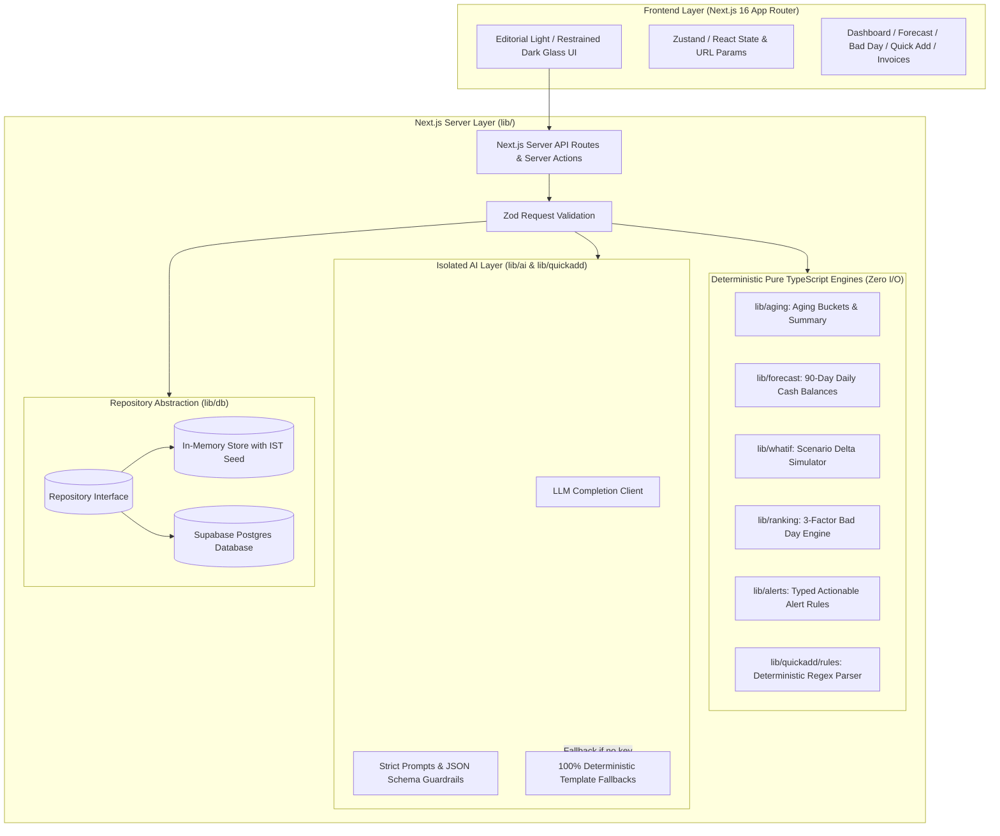

# Payday ⚡
### Cash Flow Intelligence & Receivables Operating System for Freelance Studios

[](https://nextjs.org/)
[](https://react.dev/)
[](https://www.typescriptlang.org/)
[](https://tailwindcss.com/)
[](https://vitest.dev/)
[](https://playwright.dev/)
[](LICENSE)

> **"Small creative businesses don't fail because they lack talent or clients. They fail because money arrives late and bills arrive on time."**

---

## Executive Summary

**Payday** is a one-person financial back office tailored specifically for independent wedding photographers, videographers, and boutique creative studios in India. Operating on lumpy milestone contracts (Advance → Shoot Day/Mid → Final Delivery), solo creatives often have tens of lakhs in receivables on paper while facing negative bank balances when studio rent, equipment EMIs, and assistant salaries fall due.

Traditional accounting software (Tally, QuickBooks, Zoho) is backward-looking—it records what already happened. Payday is **forward-looking receivables intelligence**: it tracks who owes what and since when, forecasts daily bank balances 90 days into the future on Indian Standard Time (IST), stress-tests cash flow with what-if scenarios, and activates **Bad Day Mode**—a deterministic ranking engine that isolates the single highest-impact invoice to chase right now with culturally tuned WhatsApp drafts and instant UPI payment links.

---

## The Persona: Arjun Verma (Arjun Visuals)

- **Role**: Freelance wedding photographer based in Mumbai with one assistant.
- **Revenue Pattern**: Highly seasonal (heavy bookings from October to February; dead monsoon season from June to August). Each client pays in 3 milestones:
  1. **Advance (20–30%)**: At contract signing / date reservation.
  2. **Mid (40–50%)**: On shoot day or upon delivery of RAW files.
  3. **Final (20–30%)**: Upon album delivery or final color-graded video release.
- **Fixed Outflows**: ₹35,000 studio rent (due on the 1st), ₹18,500 Sony FX3 / A7IV equipment EMI (due on the 10th), ₹22,000 assistant salary (due on the 5th), and Adobe Creative Cloud subscriptions.
- **Pain Point**: Clients frequently delay final and mid payments by 10 to 45 days. Chasing payments over phone calls feels uncomfortable; tracking balances in notebooks or WhatsApp chat history leads to missed collections and surprise cash crunches.
- **Locale**: India — amounts in Indian Rupees (₹), formatted in the Indian numbering system (`₹1,25,000`), payments via UPI (`upi://pay` deep links and QR codes).

---

## Key Features & Product Capabilities

### 1. Who Owes Me (Receivables Command Center)
- **Today Executive Briefing**: Natural-language human summary on load: *"You have ₹1,65,000 overdue across 3 clients. Collecting Mehta Weddings alone recovers 42% of your overdue cash."*
- **3 Real-Time KPIs**: Total Outstanding, Overdue Balance, and 90-Day Low Point, featuring tabular numbers and fluid counter animations.
- **Aging Buckets**: Invoices segmented into four actionable tiers: *Not Due*, *1–7 Days*, *8–30 Days*, and *30+ Days*.
- **Client Receivables Ledger**: Grouped by client, sorted by overdue balance, with behavioral indicators including historical payment reliability (0–100%) and average delay days.

### 2. Bad Day Mode (Signature Feature)
When cash is uncomfortably low or rent is due tomorrow, creatives shouldn't waste energy deciding who to call. Bad Day Mode ranks every overdue or upcoming invoice using a **deterministic three-factor scoring algorithm**:

$$\text{Score} = 0.50 \times \text{CashImpact} + 0.25 \times \text{Urgency} + 0.25 \times \text{Unreliability}$$

- **Cash Impact**: Improvement in the 90-day lowest projected bank balance if the invoice is collected today.
- **Urgency**: Days overdue (scaled 0–1, capped at 30 days; 0 for upcoming invoices).
- **Unreliability**: Historical client friction ($1 - \text{payment reliability score}$).
- **Action Type**: Categorizes actions into `chase` (overdue items) and `heads_up` (gentle reminder 10 days before due date for chronic late payers).
- **WhatsApp Reminder Drawer**:
  - **3 Cultural Tones**: *Friendly* (polite check-in), *Firm* (business-first reminder with deadline), *Final* (formal notice of asset hold / shoot pause).
  - **2 Languages**: *English* and natural Indian *Hinglish* (*"Arjun here! Just checking in on the balance..."*).
  - **One-Click Delivery**: Direct `https://wa.me/` deep-links with pre-encoded messages.
  - **Dynamic UPI QR Code**: Native modal rendering an instant UPI intent QR (`upi://pay?pa=arjun@upi&pn=Arjun+Visuals&am=...&tn=Invoice+INV-...`).
  - **48-Hour Cooldown Guardrail**: Prevents embarrassing accidental double-messaging.

### 3. 90-Day Cash Runway Forecast & What-If Simulator
- **Deterministic IST Projection Engine**: Runs on `Asia/Kolkata` time, avoiding calendar drift and daylight savings bugs.
- **Behavior-Adjusted Receipts**:
  $$\text{Expected Receipt Date} = \text{Invoice Due Date} + \text{Client Average Delay Days}$$
  *(Overdue invoices automatically apply a 3-day catch-up recovery window).*
- **Expense Modeling**: Expands weekly, monthly (clamped to short month ends, e.g. Feb 28 and Apr 30), and annual recurring overheads.
- **Interactive What-If Simulator**:
  - **One-Click Stress Presets**:
    - *"Rohit Mehta pays 15 days late"*
    - *"Sharma Wedding (₹1.2L) gets cancelled"*
    - *"New camera lens EMI (₹8,000/mo) added"*
  - **Live Delta Impact**: Instant side-by-side comparison of baseline vs. scenario cash floors, lowest dates, and runway health status (Healthy, Tight, Danger).

### 4. Quick Add (Natural-Language Booking Parser)
- Paste an informal WhatsApp message or single sentence:
  > *"Booked Rohit Mehta wedding for 14 Dec total 1.2L advance 30k received gpay"*
- **Dual-Engine Architecture**:
  1. **Primary AI Parser**: Context-aware LLM extraction returning structured JSON.
  2. **Deterministic Regex Engine**: 100% offline fallback parsing Indian currency shorthands (`1.2L`, `80k`, `₹80,000`, `2 lakh 50 thousand`), Indian calendar dates, advance payment statuses, and payment modes (`upi`, `cash`, `bank_transfer`).
- **Editable Preview Drawer**: Displays parsed client, event date, milestone split (`25% / 50% / 25%`), advance payment receipt, and confidence breakdown. **Zero silent writes**—the user verifies everything before saving.
- **Transactional All-or-Nothing Rollback**:
  - Atomic confirmation creates Client (if new), Booking, 3 Milestone Invoices, and Advance Payment atomically.
  - If any stage fails, automated compensation cleans up created entities in reverse order via repository `deleteBooking(id)` and `deleteClient(id)` methods on both In-Memory and Supabase modes.
  - **Duplicate Booking Prevention**: Rejects duplicate submissions for the same client, title, event date, and total amount created within the last 2 minutes. The UI disables the Confirm button while pending to prevent accidental double-submits.

### 5. Pricing & Unit Economics
- Clear transparent pricing designed for Indian creatives:
  - **Solo Tier**: ₹299 / month (or ₹2,999 / year).
  - **Studio Tier**: ₹699 / month (multi-shooter, priority WhatsApp gateway).
- **Interactive ROI Calculator**: Demonstrates how collecting just one ₹35,000 milestone 12 days earlier saves ₹4,200/month in working capital float and interest, recovering the subscription cost within 3 days.

---

## Architectural Blueprint



---

## Tech Stack & Design System

| Layer | Technology | Rationale |
| :--- | :--- | :--- |
| **Framework** | Next.js 16.4.6 (App Router + Turbopack) | Modern server-component architecture, fast builds, optimized bundle size. |
| **Language** | TypeScript 5 (Strict Mode) | Full type safety across invoices, forecast items, and database entities. |
| **UI & Styling** | Tailwind CSS v4, Lucide Icons | Utility-first CSS, high design consistency, tree-shakeable iconography. |
| **Motion** | Framer Motion & CSS Springs | Calm transitions, spring tab indicators, and rolling numbers. Zero jarring animations. |
| **Data Visualization** | Recharts | Responsive SVG charts with custom Indian compact currency tooltips. |
| **Database** | Dual Mode: In-Memory / Supabase Postgres | Zero-config instant demo out-of-the-box; production-ready Postgres persistence. |
| **Testing** | Vitest (141 unit tests) + Playwright | 100% pure function math verification + end-to-end user journey validation. |

### Editorial Precision & Design Aesthetics
- **Light Mode Canvas**: Warm Archival Paper (`#F5F3EE`) with pure white surface cards (`#FFFFFF`) and hairline stone borders (`#C8C2B5`, 1px solid, `rounded-2xl`).
- **Dark Mode Glass**: Neutral dark gradient canvas with backdrop-filter blur, hairline borders, and subtle top inner specular highlights.
- **Color Semantics**:
  - Primary Ink: Deep charcoal black (`#16181D`)
  - Muted Text: Refined graphite gray (`#5F626A`)
  - Safe / Positive: Academic forest green (`#1D6B52` on `#E3EFE8`)
  - Warning: Warm bronze amber (`#86560D` on `#F6ECD9`)
  - Danger / High Risk: Terracotta brick red (`#B53A26` on `#F8E9E4`)
- **Strict Anti-Slop Guarantee**: **Zero blinking or pulsing dots** (`animate-pulse` and `animate-ping` strictly prohibited). Status capsules and indicators remain calm, static, and dignified.

---

## Repository Structure

```
payday/
├── app/                        # Next.js App Router routes & layouts
│   ├── api/                    # Server API endpoints (alerts, forecast, quickadd, demo)
│   ├── bad-day/                # Bad Day Mode command screen
│   ├── clients/                # Client directory & payment history
│   ├── dashboard/              # Who Owes Me executive dashboard
│   ├── forecast/               # 90-day cash forecast & what-if simulator
│   ├── invoices/               # Invoices & milestone payment manager
│   ├── pricing/                # Unit economics & ROI calculator
│   ├── globals.css             # Design tokens & typography setup
│   └── layout.tsx              # Root shell layout with navigation & demo badges
├── components/                 # React UI components
│   ├── dashboard/              # KPI cards, aging breakdown, client ledger
│   ├── forecast/               # Runway charts, events timeline, what-if drawer
│   ├── invoices/               # Invoice table, milestone badges, payment modal
│   ├── quickadd/               # WhatsApp parser modal & editable preview
│   ├── reminders/              # WhatsApp drawer, tone selector, UPI QR code
│   └── shell/                  # Header, navigation, footer, guided tour modal
├── lib/                        # Core business logic (Pure functions, no I/O)
│   ├── aging/                  # Aging bucket calculations (Not due, 1-7, 8-30, 30+)
│   ├── ai/                     # Server-side LLM client with template fallbacks
│   ├── alerts/                 # Rule-based actionable alerts engine
│   ├── db/                     # Dual-mode repository (In-Memory + Supabase)
│   ├── forecast/               # 90-day IST daily cash projection engine
│   ├── money.ts                # Single canonical Indian currency formatter (₹)
│   ├── quickadd/               # Zod schemas, rules-based & AI text parsers
│   ├── ranking/                # 3-factor Bad Day ranking algorithm
│   ├── seed/                   # Dynamic relative-date synthetic seed generator
│   └── whatif/                 # Scenario simulator & cash delta computer
├── supabase/                   # Postgres schema migration & SQL seed
├── tests/                      # Automated test suite
│   ├── e2e/                    # Playwright end-to-end integration tests
│   ├── aging.test.ts           # Aging bucket unit tests
│   ├── alerts.test.ts          # Alert generation tests
│   ├── forecast.test.ts        # 90-day cash projection tests
│   ├── money.test.ts           # Indian currency & compact format tests
│   ├── quickadd.test.ts        # Natural-language parser tests
│   ├── ranking.test.ts         # Bad Day scoring tests
│   ├── repository.test.ts      # In-memory and seed generator tests
│   └── whatif.test.ts          # What-if scenario tests
├── DEMO_SCRIPT.md              # 3-minute hackathon judge demo script
├── RESPONSIBLE_AI.md           # AI safety, privacy, and fallback disclosure
├── THIRD_PARTY.md              # Third-party dependency and asset audit
├── vitest.config.ts            # Vitest unit test configuration
└── playwright.config.ts        # Playwright E2E configuration
```

---

## Getting Started

### Prerequisites
- Node.js 18.18+ or Node.js 20+
- npm or pnpm

### 1. Installation & Zero-Config Launch
Payday boots into **Demo Mode** out of the box with zero external dependencies. The in-memory store automatically generates realistic wedding photography data **relative to today** so dates never appear stale.

```bash
# Clone the repository
git clone https://github.com/Syed-Haseeb97/payday.git
cd payday

# Install dependencies
npm install

# Start development server
npm run dev
```

Open [http://localhost:3000](http://localhost:3000) in your browser.

### 2. Environment Variables (Optional)
To enable persistent Supabase storage or live AI completions, copy `.env.example` to `.env.local`:

```bash
cp .env.example .env.local
```

| Variable | Required | Description |
| :--- | :--- | :--- |
| `NEXT_PUBLIC_SUPABASE_URL` | No | Supabase project URL (if omitted, runs in In-Memory Demo Mode) |
| `NEXT_PUBLIC_SUPABASE_ANON_KEY` | No | Supabase anonymous API key |
| `SUPABASE_SERVICE_ROLE_KEY` | No | Supabase service role key (server-side only) |
| `LLM_API_KEY` | No | Groq or OpenAI API key (if omitted, deterministic templates are used) |
| `LLM_BASE_URL` | No | Base URL for LLM gateway (e.g. `https://api.groq.com/openai/v1`) |
| `LLM_MODEL` | No | Primary model (e.g. `llama-3.3-70b-versatile` or `gpt-4o-mini`) |
| `NEXT_PUBLIC_DEMO_RESET` | No | Set to `'true'` to allow resetting demo data |

---

## Test Verification

Payday is covered by a comprehensive automated test suite consisting of **149 unit tests** across 17 test suites and full **Playwright E2E integration tests**.

```bash
# Run Vitest unit tests
npm test

# Run Playwright End-to-End tests
npx playwright test

# Run ESLint validation
npm run lint

# Compile production build
npm run build
```

---

## Submission & Documentation Links

- **[Demo Walkthrough Script](DEMO_SCRIPT.md)**: A step-by-step 3-minute narrative guide designed for hackathon judges and evaluators.
- **[Responsible AI Disclosure](RESPONSIBLE_AI.md)**: Details on AI bounding, deterministic fallback guarantees, human confirmation boundaries, and privacy safeguards.
- **[Third-Party Audit](THIRD_PARTY.md)**: Complete dependency audit, open-source licenses, and design asset attribution.

---

## Synthetic Data Notice

All business names, client identities, phone numbers (+91 90000 00001–00008), email addresses, event titles, invoices, and bank transaction figures used across Payday and its demo seed are **100% synthetic**. Any resemblance to real individuals, studios, or events is purely coincidental.
